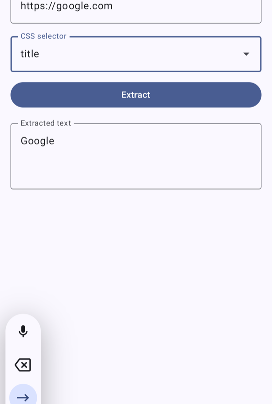
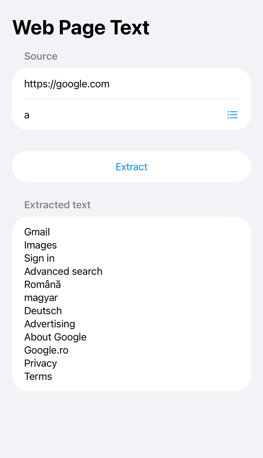

# Access Web Page Example

A small Kotlin Multiplatform project: you give it a URL and a CSS selector, it downloads the page, pulls out the matching text and shows it in a text field. The logic is written once in Kotlin and shared, while each app keeps its own native UI: Jetpack Compose on Android and SwiftUI on iOS.

The task is small on purpose, but I structured it the way I would structure a real feature, so it's easy to see where each piece would grow.

<p align="center">
  
  &nbsp;&nbsp;&nbsp;
  
</p>

## What it does

- You type any URL (`google.com` works too, `https://` is added for you) and a CSS selector.
- If you don't want to write selectors by hand, there's a short list of presets: page title, headings, paragraphs, links or the whole page. Picking one runs the extraction right away.
- Every element that matches is shown on its own line in the result field.
- If something goes wrong (no network, a 404, a selector that matches nothing), the error is shown under the result and the previous result stays on screen.

## How it's put together

```
shared/                      Kotlin Multiplatform module, used by both apps
└── commonMain
    ├── core/                DataState, BaseViewModel, ViewState
    ├── networking/          Ktor client setup
    ├── data/webpage/        fetching the HTML and parsing it
    ├── domain/webpage/      repository contract, use case, domain errors
    ├── presentation/webpage view state, selector presets, the shared ViewModel
    └── di/                  manual wiring of all the above
└── iosMain                  a small bridge so Swift can own and observe the ViewModel

androidApp/                  Jetpack Compose UI
iosApp/                      SwiftUI UI
```

A request goes through the layers in this order:

`WebPageViewModel` → `ExtractPageTextUseCase` → `WebPageRepository` → `WebPageRemoteDataSource` (Ktor) + `HtmlTextExtractor` (Ksoup)

The ViewModel exposes a single `StateFlow<WebPageViewState>`. The result lives in a `DataState` (`Idle`, `Value` or `Error`), and an error keeps the last good value, so the UI never goes blank because of one failed request.

## Decisions worth explaining

**Native UI, shared everything else.** The two UIs are deliberately thin: they render the state and forward user actions to the ViewModel. Validation, URL normalization, cancelling an old request when a new one starts, error handling: all of that is written once, in `shared`.

**Ktor + Ksoup.** Ktor uses OkHttp on Android and `NSURLSession` on iOS, and the right engine is chosen through dependencies alone. That's why the project needs no `expect`/`actual` for networking. Ksoup is a multiplatform port of jsoup, so selectors behave the way you'd expect from a browser.

**One shared ViewModel.** `WebPageViewModel` extends the multiplatform `androidx.lifecycle.ViewModel`. Android uses it like any other ViewModel. On iOS, `WebPageViewModelOwner` gives it a `ViewModelStore` and turns the `StateFlow` into a plain callback, and a thin `@Observable` Swift class publishes that state to SwiftUI. When the Swift side goes away, the store is cleared and every coroutine is cancelled.

**Presets live in shared, labels don't.** The list of selectors is defined once in Kotlin. The human-readable labels are localized natively, in `strings.xml` on Android and in Swift on iOS, because that's where translations belong.

**Manual DI.** With a single screen, a small `SharedModule` is easier to read than a DI framework. Swapping it for Koin later wouldn't touch any other layer.

## Running it

You'll need Android Studio with the Kotlin Multiplatform plugin, Xcode 26.2 or newer, and JDK 21. The JDK that ships with Android Studio works fine.

**Android**

```bash
./gradlew :androidApp:installDebug
```

Or pick the `androidApp` run configuration in Android Studio.

**iOS**

Open `iosApp/iosApp.xcodeproj` in Xcode and hit Run. A build phase compiles the shared Kotlin framework automatically, so there's nothing to build by hand first.

**Tests**

The tests live in `commonTest` and run on both platforms. They cover the HTML extractor, the repository (with Ktor's `MockEngine`), the use case and the ViewModel.

```bash
./gradlew :shared:testAndroidHostTest :shared:iosSimulatorArm64Test
```

## What I'd do next

- Map exceptions to friendly, localized messages instead of showing the raw exception message.
- Support reading attributes too, for example `meta[name=description]`, which has no visible text.
- Add [SKIE](https://skie.touchlab.co) so Swift gets real enums and can consume `Flow` as an `AsyncSequence`. That would remove most of the iOS bridge code.
- Add Ktor's `Logging` plugin in debug builds.
